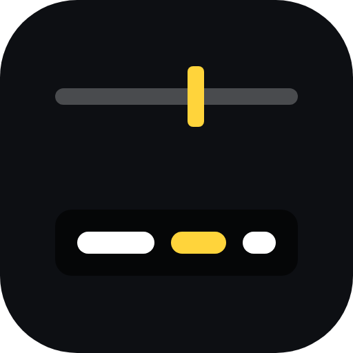
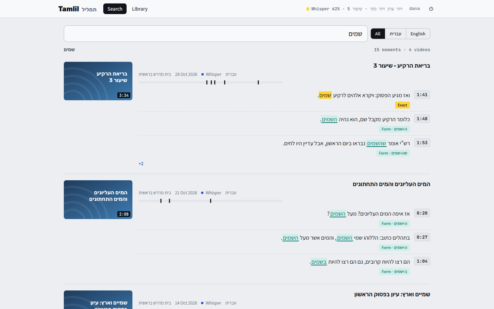
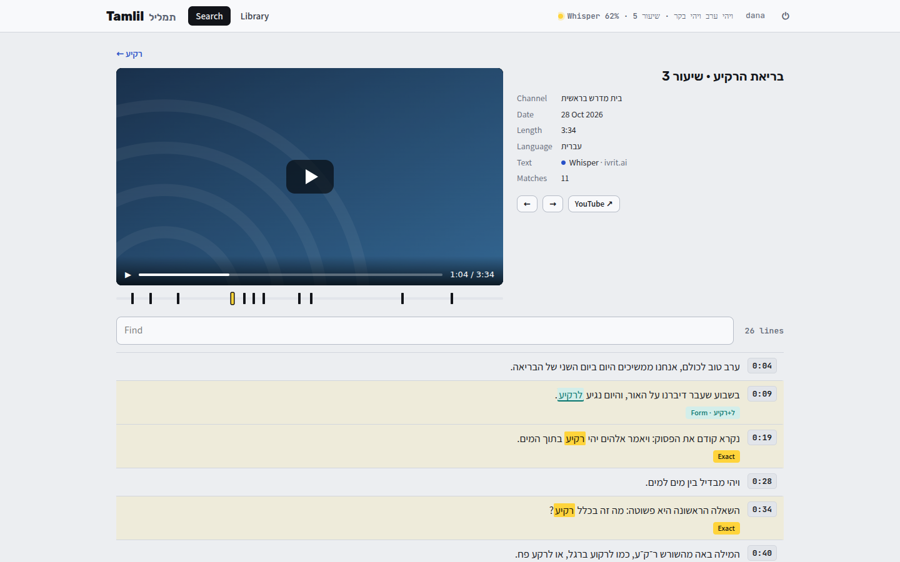
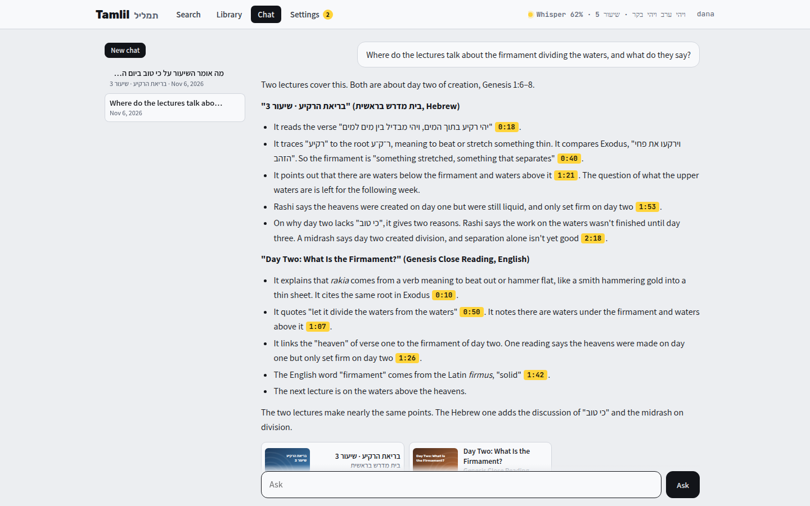
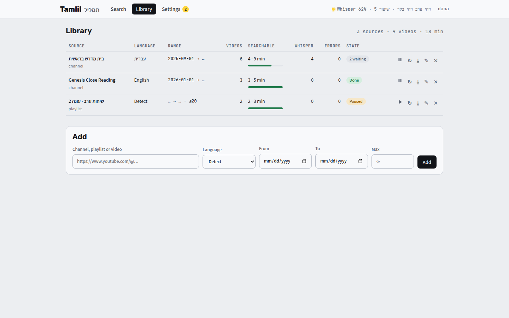
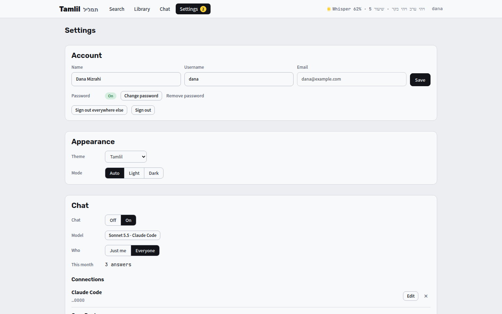
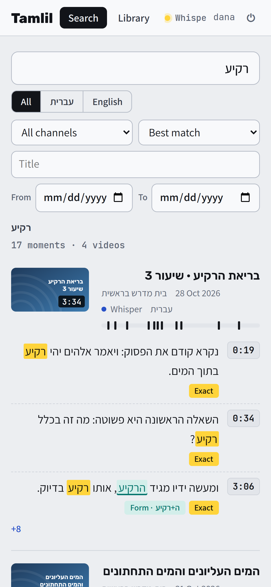
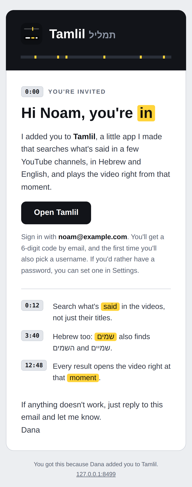

<p align="center">
  
</p>
<h1 align="center">Tamlil</h1>
<p align="center"><b>Search YouTube videos by what's said in them, in Hebrew and English.</b><br>It reads the captions, writes its own transcript when there aren't any, and opens the video right at the moment it was said.</p>
<p align="center">
  
  
  
  
  
</p>
<p align="center">
  <a href="docs/README.md"><b>Docs</b></a> ·
  <a href="#why-i-made-it">Why I made it</a> ·
  <a href="#what-it-does">What it does</a> ·
  <a href="#screenshots">Screenshots</a> ·
  <a href="#running-it">Running it</a> ·
  <a href="#how-its-built">How it's built</a> ·
  <a href="#license">License</a>
</p>



## Why I made it

I wanted to search YouTube videos by what's actually SAID in them, not just their titles. You remember that someone explained something, but not in which video, or where in the video, and YouTube's own search only looks at titles and descriptions. In Hebrew it's even harder, because a lot of Hebrew videos don't have captions at all.

So Tamlil (תמליל, Hebrew for a transcript) keeps an eye on the few channels and playlists I pick, over the dates I pick. Where a video has good captions, it uses them. Where it doesn't, it listens to the video itself with Whisper, using ivrit.ai's model for Hebrew. Then I can search all of it at once, and every result opens the video right at that moment.

## What it does

- **Watches a few channels:** a channel, a playlist or one video, with a date range and a limit, checked again every 6 hours. Links from Invidious and Materialious work too. See [The Library](docs/the-library.md).
- **Captions first, Whisper second:** the uploader's own captions when there are some in the spoken language, YouTube's automatic ones for English only, and otherwise its own transcript on the CPU. See [How it works](docs/how-it-works.md).
- **Search that knows Hebrew:** it finds שמים in השמים and ושמים, in שמיים, and with or without niqqud, and tells you which kind of match each one is. A channel, words in the title and dates narrow it down, sorted by best match, newest, oldest or most moments. See [Searching](docs/searching.md).
- **Opens at the moment:** a private player starts at the line, with the whole transcript under it, a tick on the timeline for every match, and ← → to step through them. See [Watching](docs/watching.md).
- **Its own VPN:** everything that talks to YouTube goes through the stack's own gluetun, so it never uses the server's own address.
- **Ask Claude, or another model:** a chat about the videos. The model searches and reads the transcripts and answers with the moments it got it from. It can be Claude on the owner's own plan through Claude Code, or a model through a Claude key, OpenRouter, OpenAI, Gemini, Ollama or anything else that speaks the OpenAI chat format. See [Chat](docs/chat.md).
- **Share and export:** a link to a transcript that anyone can open, and every transcript as text, subtitles (`.srt`, `.vtt`) or JSON, one video or a whole channel. See [Watching](docs/watching.md#sharing-and-exporting).
- **Pause a channel:** it keeps everything it has and the worker skips it, until it's picked up again.
- **Invite only:** I invite people by email, or they ask for an invite and I say yes. They sign in with a code by email or a password, and Settings has their account. See [Signing in, people and Settings](docs/people.md).
- **Themes:** fourteen of them, each light and dark, picked per device in Settings. See [Settings](docs/people.md#settings).

## Screenshots









<p align="center"> </p>

The pictures are from `tools/demo.py`, a demo with made-up channels and lectures, never from my own Tamlil.

## Running it

It's a Docker Compose stack: the app, its worker, its own VPN (gluetun) and its own Invidious for the player.

```sh
cp .env.example .env              # a WireGuard key for the VPN, and three secrets for Invidious
docker compose up -d --build      # then open http://127.0.0.1:8445
docker exec tamlil-web python -m tamlil.accounts allow you@example.com --quiet
```

On the same machine it's open with no sign-in. To open it from anywhere, put it behind a tunnel or a proxy and give it a mail server for the codes. All of that is in [Developing and running it](docs/DEVELOPING.md).

Whisper runs on the CPU, so it's slow: about 25 minutes for an hour of Hebrew on 8 threads. Captions take seconds. It's made for a few channels and a few people, not a whole archive.

## How it's built

- `app/tamlil/`: the app, in Python. `web.py` is the page's server (FastAPI), `worker.py` lists the channels and gets the transcripts, `fetch.py` talks to YouTube through yt-dlp, `transcribe.py` runs faster-whisper, `hebrew.py` is the Hebrew matching, `search.py` searches SQLite's full-text index, `links.py` turns YouTube, Invidious and Materialious links into YouTube's own, `export.py` writes the transcripts out, `chat.py` is the chat, with Claude or another model, and `accounts.py`, `emails.py` and `mail.py` are the accounts, the invites and the emails.
- `app/tamlil/static/`: the page, in plain HTML, CSS and JavaScript.
- `gateway/`: Caddy in front of everything, so the app and its player share one address and one sign-in.
- `invidious/`: the player's database setup, from Invidious.
- `app/tests/`: the tests. `tools/demo.py`: the demo for the pictures.

Everything it keeps is in one folder (the database, the people, the mail settings, and the key or token for the chat), so nothing secret lives in this repo. More in [Developing and running it](docs/DEVELOPING.md).

## License

MIT, see [LICENSE](LICENSE). The files in `invidious/` are Invidious's own, under the AGPL-3.0, and the fonts are under the SIL Open Font License ([OFL.txt](app/tamlil/static/fonts/OFL.txt)).
