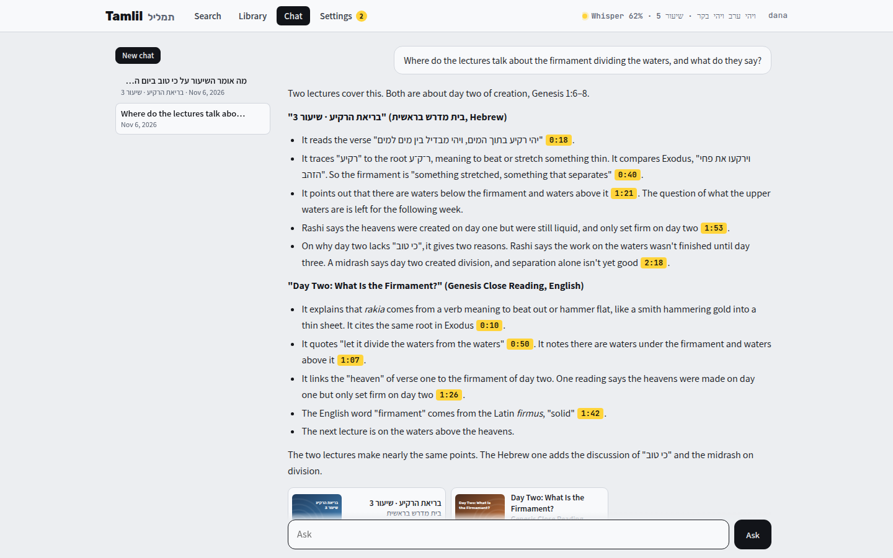
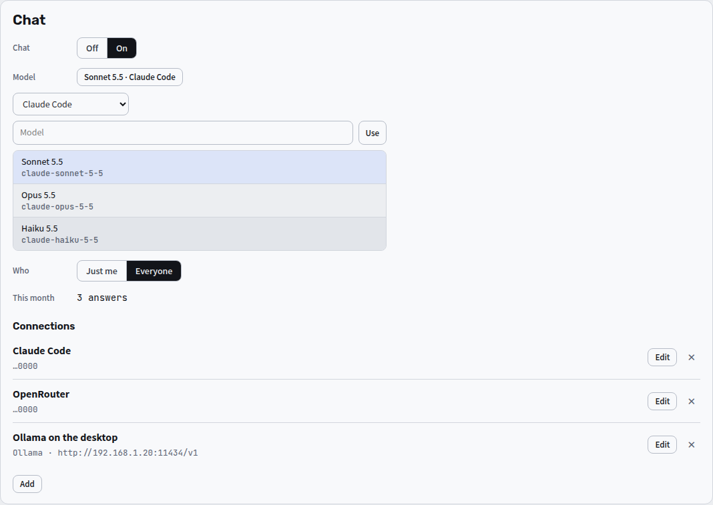

[Tamlil docs](README.md) › Using it

# Chat

Search is for when I remember the words. Chat is for when I remember the idea: I ask Claude a question about the videos (or another model, through ChatGPT, OpenRouter, Ollama and the like), and it looks through the transcripts for me. It searches them the same way the search box does, reads the parts it needs, and answers with the moments it got them from. Every yellow time in an answer opens the video right there.

*One question about the whole library, answered from two lectures.*

## Asking

- **Chat** at the top opens a new chat. Pick **All channels** or one channel, type the question, and **Ask** (or Enter; Shift+Enter starts a new line).
- **Ask** on a video opens a chat about that one video. Claude gets its whole transcript, so the answers come quickly.
- While Claude works, the line under the question says what it's doing: **Searching** a word, **Reading** a video, or **Listing videos**. The answer then appears as it's written. **Stop** ends it there, and what it wrote so far is kept.
- You can look at other screens while it works. The answer keeps being written, and when you come back to the chat it's there, or still on its way. Enter waits until it's done, so a follow-up you type in the meantime goes when you press Enter again.
- Ask more in the same chat, and Claude keeps the earlier questions and answers in mind.
- Each time in an answer opens the video at that moment, and the videos it cited are under the answer.
- It answers in the language you ask in, whatever language the videos are in. It searches Hebrew channels in Hebrew either way.
- The chats are kept, newest first, on the left. **✕** deletes one. Your chats are yours alone: nobody else sees them in Tamlil, the owner included.

The transcripts come from captions or from Whisper, so they have mistakes, most of all in names. Claude is told to say when a line looks garbled, and the time next to it is there so you can listen for yourself.

## Turning it on

Chat is the owner's to turn on, in **Settings** under **Chat**. First it needs a connection, which is where the answers come from. **Add** one under **Connections**:

- **Claude Code:** Claude on the owner's own Claude plan, with no API key. Run `claude setup-token` on any computer that has Claude Code. It opens the browser to sign in, then prints a long-lived token, and that goes in **Token**. Answers count toward the plan's usage, the same as using Claude Code yourself.
- **Claude:** a key from the Claude Console. Every answer is paid for by that key's account.
- **ChatGPT:** GPT on the owner's own ChatGPT plan, with no key. **Continue with ChatGPT** opens OpenAI's sign-in in a new tab. Unless that browser is on the computer Tamlil runs on, the tab ends on a page that doesn't load, and that's expected: its address goes in **Address from the ChatGPT tab**, and **Connect** finishes the sign-in. Answers count toward the plan's usage, and **✕** on it signs out at OpenAI too.
- **OpenRouter:** one key for almost every model there is, Claude, GPT, Gemini, Llama, DeepSeek and the rest, paid for by the OpenRouter account. Its list only shows the models that can use tools, since the chat can't search without them.
- **OpenAI** and **Gemini:** a key from each.
- **Ollama:** models on your own computer, with no key. The address starts out as Ollama on the same computer as Tamlil, and can point at another one.
- **Other:** anything else that speaks the OpenAI chat format, like LM Studio or vLLM, with its address and a key if it needs one.

Then:

- **Model:** pick a connection, and then a model from its list, or type a model's name and **Use** it. Claude Code and Claude start out on Sonnet 5.5. Opus 5.5 is slower and more careful, and Haiku 5.5 is the quickest and the cheapest.
- **Chat:** **On** or **Off**.
- **Who:** **Just me** (the owner, and anyone on the tailnet) or **Everyone** on the list. Everyone but the owner gets 60 questions a day.
- **This month** counts the answers, and adds up what they cost where the service says (a Claude key and OpenRouter do).

**Edit** changes a connection's name, key or address (a key left empty stays as it was), and **✕** removes it, after asking once more.

## What the model can and can't do

- It has three tools, and all three only read: **search** (the search box's own search, with the same filters), **transcript** (a video's lines with their times) and **videos** (what's in the Library). It can't change the Library, see the people, or reach anything else.
- With Claude Code, every one of Claude Code's own tools is off: no files, no commands and no web. Its settings aren't loaded, and a question goes to it as plain text, so a file name or a slash command in a question is only words.
- A model that can't use tools can't search, so it says so instead of answering.
- What goes to the service is the question, the chat's earlier questions and answers, the list of channels, and the transcript lines the model reads.
- The keys and the token are kept in `chat.json` in the data folder, and ChatGPT's sign-in in `chatgpt.json`, which only their owner can read. Settings shows just their last four characters.

Next: [Signing in, people and Settings](people.md)
