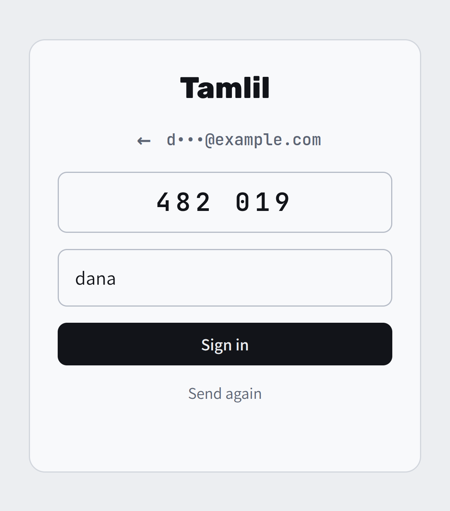
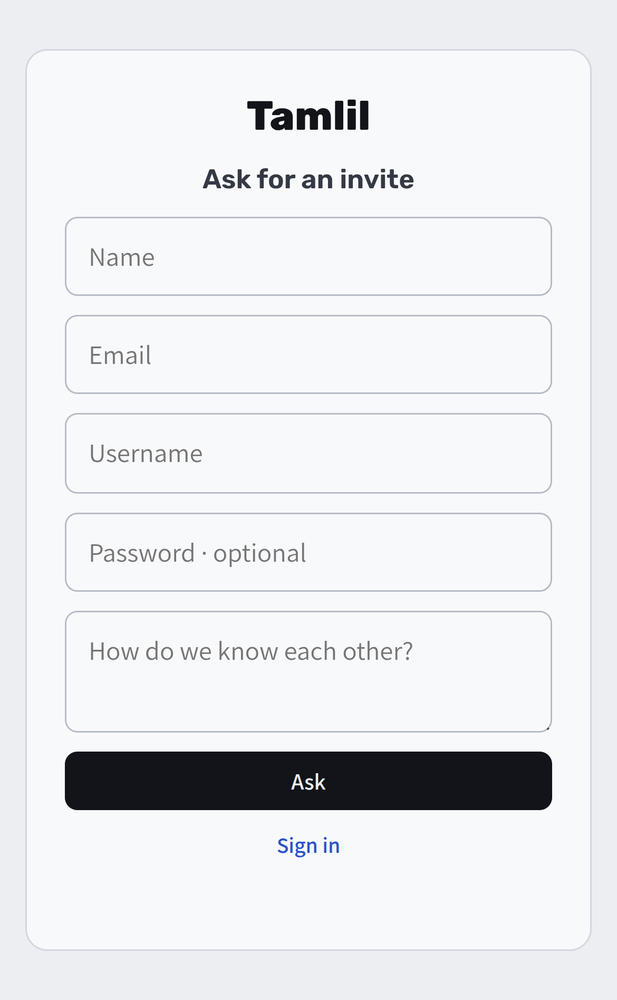
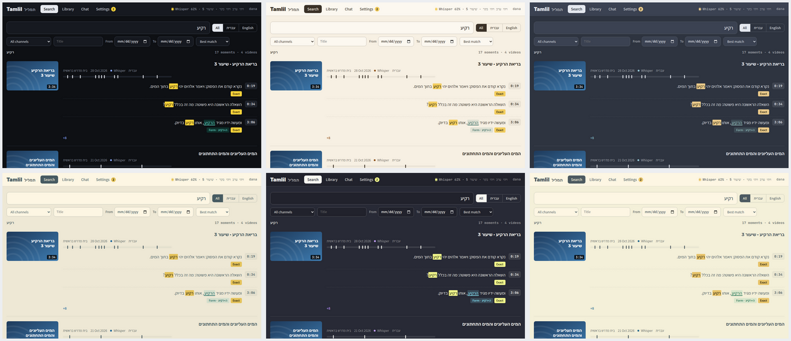
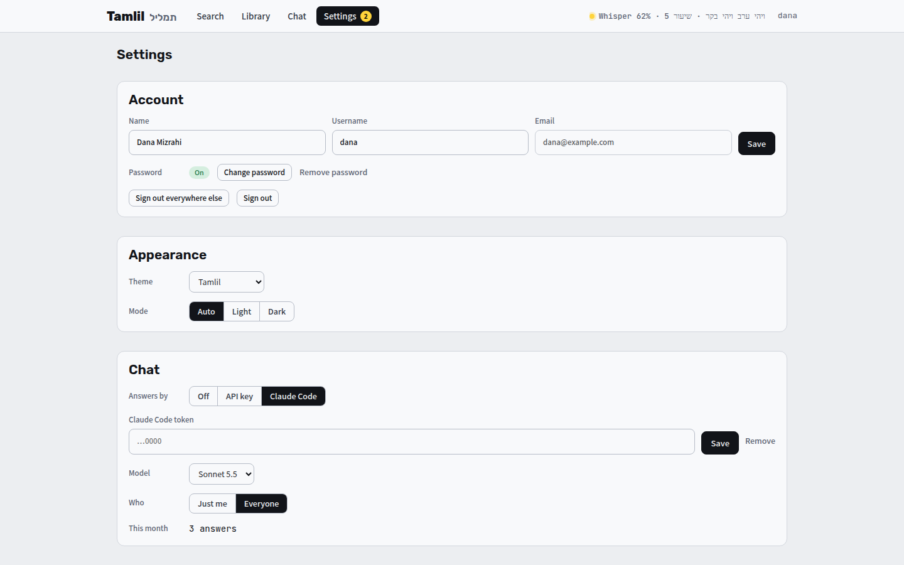
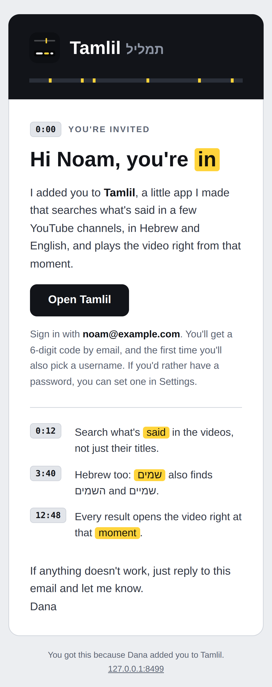

[Tamlil docs](README.md) › Using it

# Signing in, people and Settings

Tamlil is for a few people. I invite them by email, or they ask for an invite and I say yes. Everyone signs in with a code that comes by email, or with a password if they set one.

## Signing in

1. Open Tamlil, type your email or your username, and **Send code**.
2. A 6-digit code comes by email. It works for 10 minutes.
3. Type the code. The first time, there's also a box to pick a username: 2 to 32 letters, numbers, dots, dashes or underscores.
4. **Sign in.**

Anyone who set a password can tap **Use a password** instead, and Tamlil remembers which way you like on that browser. The code always works too, so a forgotten password is never a lockout.

Signing in lasts 180 days on that browser, and it moves forward on each day you use it. On the tailnet there's no sign-in at all.

If the code doesn't come, look in spam, or **Send again**. **←** goes back to change the address.

## Asking for an invite

Someone who isn't on the list can tap **Ask for an invite**, or open the `/join` link I send them. They fill in their name, their email, the username they want, a password if they'd like one, and how we know each other. Then a code comes to that email, so nobody can ask in someone else's name, and once they type it the request waits for me.

I get an email about each request, and when I say yes, they get one that says they're in, with the username and password they picked already set up.

## Settings

**Settings** at the top is where your account is:

- **Name** and **Username:** change them any time. A new username doesn't sign you out anywhere.
- **Password:** set one, change it, or remove it. Setting or changing it signs you out on every other device, and changing or removing it asks for the current one first. Passwords are at least 8 characters.
- **Sign out everywhere else** signs out every other browser and phone, and keeps this one.
- **Sign out.**

**Appearance** is there for everyone, the tailnet too:

- **Theme** is Tamlil's colors, picked from a list: Tamlil's own, then Paper, Blue pencil, Nord, Solarized, Gruvbox, Catppuccin, Rosé Pine, Tokyo Night, Dracula, Everforest, E-ink, High contrast and Black. It changes as soon as you pick one, and every theme has a light and a dark version, with the highlight in its own yellow.
- **Mode** is **Auto** (light or dark with the device), **Light** or **Dark**.

Both are kept in the browser, so the phone and the computer can each have their own.

The owner also sees **Chat** there, which is where chat is turned on (see [Chat](chat.md#turning-it-on)).

## People, for the owner

The first address on the list is the owner's. The owner sees **People** in Settings, and so does anyone on the tailnet. The yellow number next to Settings is how many requests are waiting.

- **Requests:** each one has the name, the email, the username and how we know each other. **Approve** makes the account and sends the welcome email. **Decline** just takes the request away, without an email.
- **Invite:** type an email, and a name if you like (the email greets them by it). They're on the list right away, and they get an email from me with the address and how to sign in.
- **Invited** means they haven't signed in yet, and **Send again** sends the invite once more.
- **✕** takes someone off the list, after asking once more. They're signed out everywhere at once, and if they're ever added back, their old sign-in doesn't come back with them.
- **Requests: Open or Closed** turns asking for an invite on and off, and **Copy** copies the `/join` link.
- **Email me: On or Off** is whether a new request sends me an email.

Everyone on the list can search, watch and change the Library. Only the owner sees People.

## The emails

Every email comes from the address in `mail.json`, in Tamlil's own colors, with a plain text copy for mail apps that want one. There are four: the code, the invite, the welcome after a yes, and the note to the owner about a request.

## Keeping it safe

- Only addresses on the list can get a sign-in code, so nobody can use Tamlil to send email to anyone else.
- Codes: 6 per IP address an hour, 3 to one address every 15 minutes and 8 a day, and 100 an hour in all. Each code works for 10 minutes and 5 tries, and 20 wrong codes from one IP address in an hour stop it for a while.
- Passwords are kept as scrypt hashes, never the password itself. 12 tries from one IP address in 15 minutes, and 8 wrong for one username or email locks it for 15 minutes (the code still works).
- Requests: 4 per IP address an hour, 3 for one address an hour, 30 a day, and never more than 50 waiting.
- Outside the tailnet, the sign-in is checked on every request, the video itself included. The only things open without it are the sign-in pages and the transcripts someone chose to share (see [Watching](watching.md#sharing-and-exporting)).

Next: [How it works](how-it-works.md)
