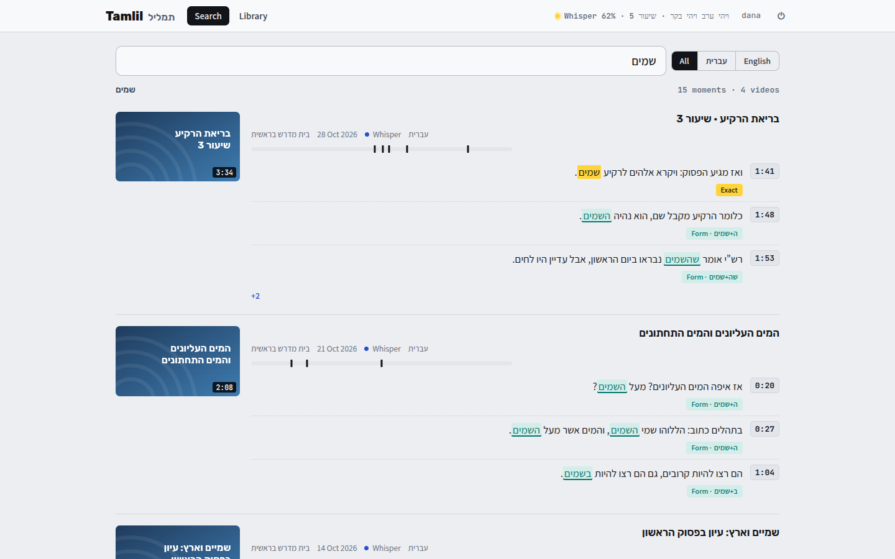
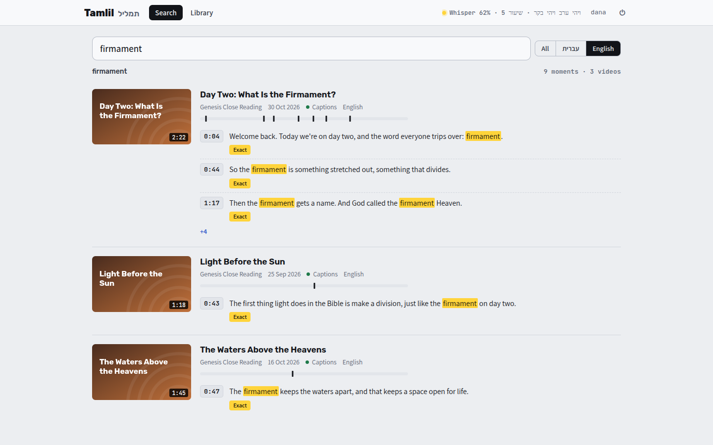

[Tamlil docs](README.md) › Using it

# Searching

Type a word or a few words in **Search**, in Hebrew or English, and press Enter. On a computer, **/** jumps to the search box from anywhere.

*Each video with its best moments, and the label that says how each line matched.*

- **All · עברית · English** limits it to videos in one language.
- With a few words, it first looks for half-minute stretches that have ALL of them. If nothing does, it shows what has any of them.
- Little words like "the", "and", של and את are left out.

## The results

Each result is one video: its picture, title, channel, date, where its text came from, and its language. The videos with the best matches come first.

- **The bar under the title** has a tick for every moment in the video that matched, so you can see where it talks about it most.
- **The moments** are its best three, in order, each with its time. **+N** under them means there are more, and it opens the video with all of them.
- **The time** opens the video right there. See [Watching](watching.md).

*The same search in English: "firmament" in three videos.*

## How Hebrew words match

Hebrew writes the same word in more than one way, so Tamlil looks for all of them and says which kind each match is:

| Label | What it means | Searching שמים finds |
|---|---|---|
| **Exact** | the word itself | שמים |
| **Form** | the word with a prefix: ו ה ב כ ל מ ש, up to three of them | השמים, ושמים, בשמים, שהשמים |
| **Spelling** | the same word with an extra or a missing ו or י | שמיים, השמיים |

On top of that:

- Niqqud and cantillation marks are ignored, so שָׁמַיִם is the same as שמים.
- Final letters (ם and מ) don't matter, and neither do quote marks and geresh, so רש"י finds רשי.
- אלוקים and אלקים count as אלוהים.
- Prefixes come off the words in the transcripts, never off what you type. So searching שמים never finds המים.

Each line shows its label with the form it found, like ה+שמים.

English is simpler: capitals don't matter, and a word matches the same word.

Next: [Watching](watching.md)
