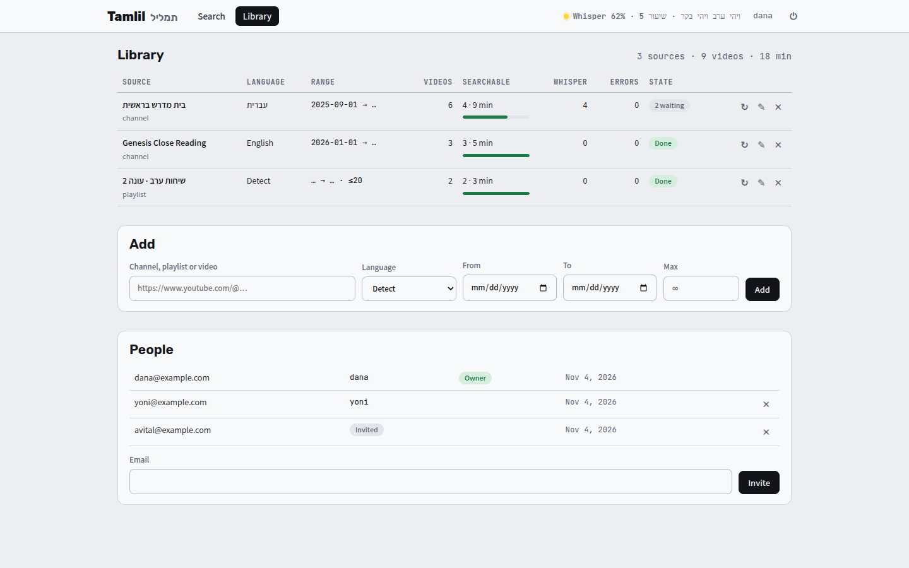

[Tamlil docs](README.md) › Using it

# The Library

The Library is where the channels are. Each row is one source: a channel, a playlist or a single video.

*Three sources, how much of each is searchable, and People under them.*

## Adding a channel

Under **Add**:

- **Channel, playlist or video:** its YouTube link. A channel's page, its @handle or its Videos tab all work.
- **Language:** עברית or English if I know it, so it uses the right Whisper model straight away. With **Detect**, it works it out from the captions, or listens to 30 seconds from the middle of the video.
- **From** and **To:** only videos uploaded between these dates. Either one can be empty.
- **Max:** at most this many videos. Empty means no limit.

Then **Add**, and it starts within a few seconds.

## What happens next

The worker goes through the source newest first, 10 videos at a time, and gets the text of each batch before it lists the next one. That way the newest videos are searchable within minutes, and the rest keep filling in behind them.

- A video with good captions takes a few seconds.
- A video without them goes through Whisper, which takes about 25 minutes for an hour of Hebrew. See [How it works](how-it-works.md).
- On a channel, once it reaches 3 videos in a row older than **From**, it stops, since the rest are older still.
- Live streams, premieres that haven't happened yet, and private, members-only or removed videos are skipped.

Every 6 hours it looks at each source again for new videos. On a channel that's quick, because it stops as soon as it sees 5 in a row that it already has.

## The table

| Column | What it shows |
|---|---|
| Source | its name, and whether it's a channel, a playlist or a video. Click it to see every video in it. |
| Language | עברית, English or Detect |
| Range | From → To, and the Max |
| Videos | how many videos it found in the range |
| Searchable | how many are done, how long they are together, and a bar |
| Whisper | how many of those went through Whisper |
| Errors | videos that failed |
| State | **Listing**, **N waiting**, **Done**, or **Error** if listing the source failed |

A source's videos open under it, newest first, each with where its text came from (**Captions**, **Auto captions** or **Whisper**), or its state if it isn't done yet. A video that fails is tried again after half an hour and then after an hour. After 3 tries it shows **Error**, the reason, and a **Retry** button.

The buttons on each row:

- **↻** looks for new videos now, without waiting for the 6 hours.
- **✎** changes the language, the dates and the max. It lists the source again from the top with the new settings, and keeps the videos it already has.
- **✕** deletes the source with all its transcripts. It asks once more ("Delete?") first.

## People

Below the table, the owner sees **People**. See [People and signing in](people.md).

Next: [Searching](searching.md)
