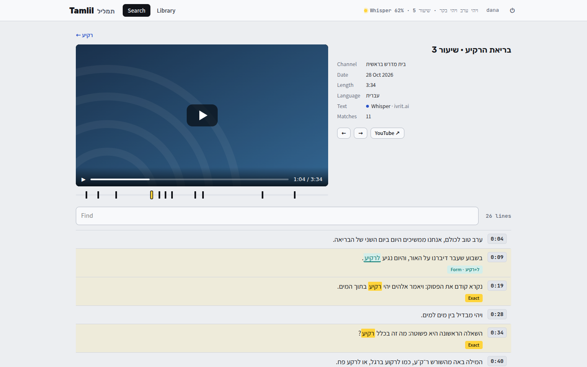
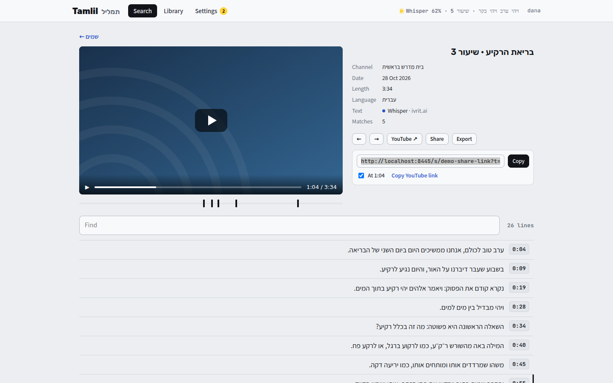

[Tamlil docs](README.md) › Using it

# Watching

Clicking a moment opens the video at that line, with its whole transcript under it.

*The player at the moment, a tick for each of the 11 matches, and the transcript.*

- **The player** is a private Invidious that runs next to Tamlil, so the video plays without YouTube's page around it and starts at the moment.
- **The ticks** under the player are every match in this video. Click one to jump there. The one you're on is yellow.
- **← →** go to the previous or the next match.
- **YouTube ↗** opens the same moment on YouTube.
- **← and the search**, above the player, go back to the results.

Next to the player are the channel, the date, the length, the language, where the text came from (with ivrit.ai when it's Hebrew Whisper), and how many lines matched.

## The transcript

Every line has its time, and clicking the time jumps the player there. The lines that matched are tinted and carry their label (**Exact**, **Form** or **Spelling**, see [Searching](searching.md)), and the line the player is on has a mark at its side.

**Find** looks for any text in this one transcript as you type, ignoring niqqud, and highlights it. The count next to it says how many lines have it.

## Sharing and exporting

**Share** makes a link to this video's transcript that anyone can open, even without an account. It opens a plain page with the video (from YouTube itself), the whole transcript and Find. With **At 1:04** ticked, the link starts at the moment you're on, and that line is marked. **Copy** copies it, **Send…** (on a phone) opens the phone's own share sheet, and **Copy YouTube link** copies YouTube's link at the same moment.

There's one link per video, so sharing it again gives the same link with a new time. Every shared link is listed in Settings under **Shared links**, where **✕** stops it working. People see the links they made, and the owner sees all of them.

**Export** downloads the transcript:

- **Text:** the title, the channel, the date and the YouTube link, then every line with its time, like `[12:48] …`.
- **Subtitles:** `.srt` or `.vtt`, for a video player or a subtitle editor.
- **JSON:** every line with its start and end in milliseconds, for anything else.

A whole channel can be exported from the Library too (see [The Library](the-library.md#exporting-a-source)).

Next: [Signing in, people and Settings](people.md)
