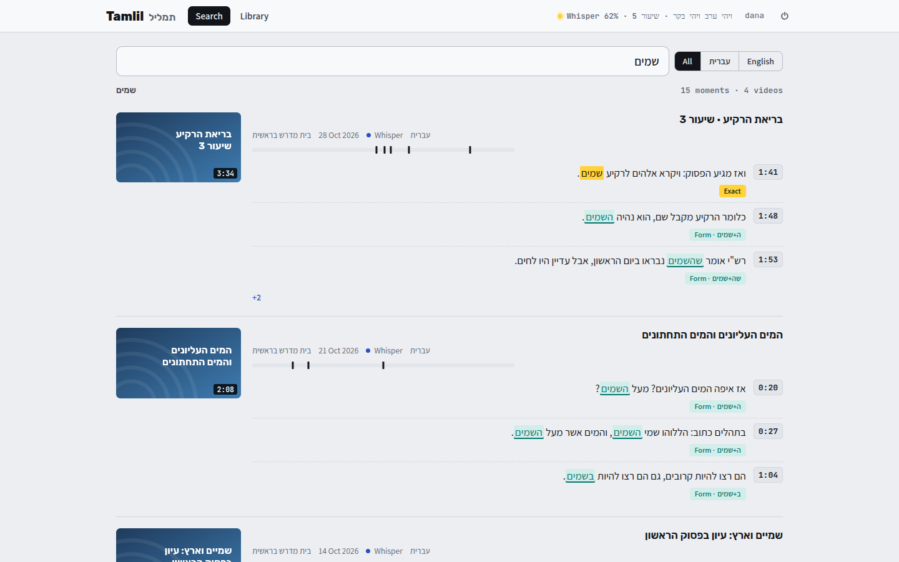
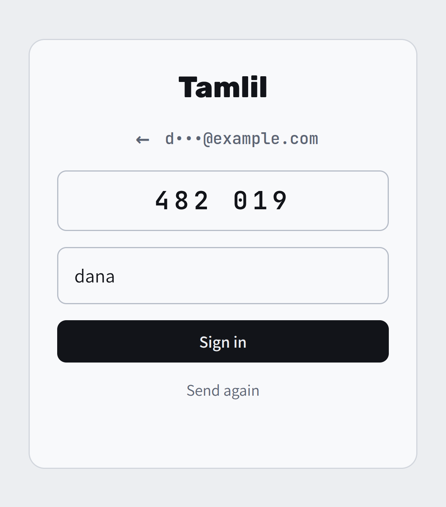

[Tamlil docs](README.md) › Getting started

# What is Tamlil?

Tamlil searches YouTube videos by what's said in them. I give it a few channels or playlists and a date range, and it gets the text of every video: the captions when there are good ones, and otherwise it listens to the video itself with Whisper. Then one search goes through all of it at once, in Hebrew or English, and every result opens the video right at that line.

The name is the Hebrew תמליל, a transcript.

*Four videos that say שמים, each with its best moments and how each one matched.*

## What it does on its own

- **Lists** each channel or playlist, newest first and within its dates, 10 videos at a time, and looks again every 6 hours for new ones. See [The Library](the-library.md).
- **Gets the text** of each video: the uploader's captions, YouTube's automatic ones for English, or Whisper. See [How it works](how-it-works.md).
- **Keeps up with YouTube:** yt-dlp, the part that talks to YouTube, updates itself once a day.

## What I do

- Add the channels and set their dates, in the Library.
- Search, and open the moments I want. See [Searching](searching.md) and [Watching](watching.md).
- Invite the few people who use it with me. See [People and signing in](people.md).

## Where I open it

- **On the tailnet:** port 8445 on my server's tailnet address. No sign-in, because Tailscale already knows it's me.
- **Anywhere else:** https://tamlil.tiresia.xyz, where everyone signs in with a code by email.

The bar at the top shows what the worker is doing right now: **Idle**, **Listing**, **Captions**, **Audio** (getting the sound for Whisper), **Whisper** with how far along it is, or **Worker offline** if it hasn't checked in for 3 minutes.

Next: [The Library](the-library.md)
